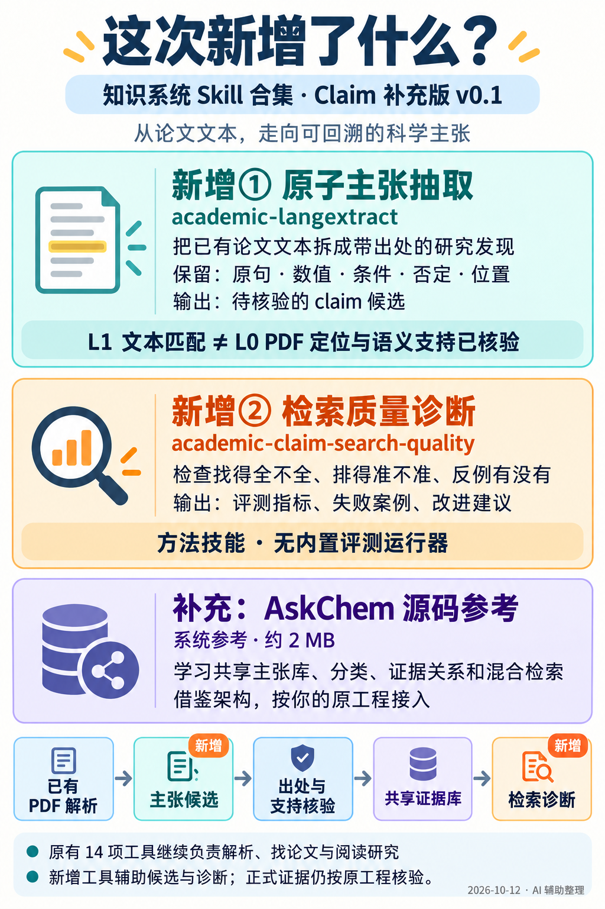

# 学术证据工作流 · Skill合集

16项可携带技能，涵盖PDF转写、claim候选、检索、引用与研究。JT为朋友准备，AI参与选型、适配与测试。

## 最新完整包v0.3.0

2026-10-21：依据5篇真实材料的本机测试，更新PDF转写、MinerU和Docling三项；其余13项保持旧文件。完整ZIP也纳入既有定向候选和WorkBuddy提示词，方便一次转交。

- [下载完整技能包v0.3.0](https://github.com/jterroblate/academic-evidence-skills/releases/download/v0.3.0/academic-evidence-skills-v0.3.0.zip)
- [百度网盘备用下载](https://pan.baidu.com/s/1f3K5zh1reqVOv8RATJUwjw?pwd=akkx)，提取码 `akkx`。下载的是完整技能 ZIP；已回下载核对 SHA256，与 GitHub 文件一致。
- [先读与安装](academic-evidence-skills-v0.3.0/README_先读.md) · [16项用法](academic-evidence-skills-v0.3.0/每个技能怎么用.md)
- [PDF公式实测结论与范围](academic-evidence-skills-v0.3.0/PDF公式更新与实测范围.md) · [验证说明](academic-evidence-skills-v0.3.0/验证说明.md)
- [发给WorkBuddy的公式任务提示词](workbuddy/PDF_FORMULA_TASK.md) · [项目启动提示词](workbuddy/START_HERE.md) · [交接说明](workbuddy/README.md)
- [公式核验流程图](academic-evidence-skills-v0.3.0/讲解图/PDF公式保真流程_2026-10-21.png) · [三项技能怎样配合](academic-evidence-skills-v0.3.0/讲解图/WorkBuddy三项技能怎么配合_2026-10-21.png)

SHA256：`c656a03342709c83c8ebaa0c409c41fbc7e0e2111ddd8be35836d7762102513b`

本组样本优先建议继续测试MinerU 4.0.12 basic/ONNX。已完成5篇103页文字基线各2次、两个公式后端各5代表页、MinerU另5篇103页全文与同页复跑；没有完成全部103页的公式逐项核验。新检查器可查完整性和基本数学词法，零问题仍不证明公式正确。WorkBuddy导入与原系统接入仍需接收环境实际验证。

包内候选11个目录包含中英版本/primer，仍是静态参考，不计入正式16项，也不等于11项独立能力。论文、会议、私有设计、原文转写、环境与模型不公开。

## 历史交付

[v0.2.0完整包](https://github.com/jterroblate/academic-evidence-skills/releases/tag/v0.2.0)、[WorkBuddy v0.1交接](https://github.com/jterroblate/academic-evidence-skills/releases/tag/workbuddy-handoff-v0.1)保留历史版本；新用户优先下载上面的v0.3.0。

## Claim 中心工作流补充包

[下载本轮讲解图 PNG](https://github.com/jterroblate/academic-evidence-skills/releases/download/claim-supplement-v0.1/claim-supplement-explainer-v0.1.png)



基于AskChem完整音轨、幻灯片与原论文/源码复核，新增两个窄技能及固定系统参考。先看共享claim库、出处核验与小金标评测，再决定扩展服务。

- [下载补充包ZIP](https://github.com/jterroblate/academic-evidence-skills/releases/download/claim-supplement-v0.1/claim-centered-supplement-v0.1.zip)
- [中文入口与两个技能用法](claim-centered-supplement-v0.1/README_先读.md)
- [精选工具及起步顺序](claim-centered-supplement-v0.1/工具用途与起步顺序.md)
- [补充包验证边界](claim-centered-supplement-v0.1/验证说明.md)

`academic-langextract`处理已有L1文本的typed claim候选与跨度；`academic-claim-search-quality`指导golden set、召回/排序、反例与过滤诊断。另含AskChem固定源码约2MB，不含其大型数据库或模型。这些是方法技能与技术参考，正式Compiler、Registry和eval runner仍需目标工程实现；未代测真实provider与朋友论文效果。

## 基础包下载与入门

- [下载 v0.1.0 ZIP](https://github.com/jterroblate/academic-evidence-skills/releases/download/v0.1.0/academic-evidence-skills-v0.1.0.zip)
- [安装与第一篇PDF](academic-evidence-skills-v0.1.0/README_先读.md)
- [每个技能怎么用](academic-evidence-skills-v0.1.0/每个技能怎么用.md)
- [技能目录](academic-evidence-skills-v0.1.0/skills)
- [来源、固定版本和改动](academic-evidence-skills-v0.1.0/来源与修改.md)
- [验证范围](academic-evidence-skills-v0.1.0/验证说明.md)

第一次可只选 `pdf-to-markdown` 和 `academic-docling`；已有解析渠道则直接接入已有结果。支持SKILL.md的agent可安装完整技能文件夹，具体路径与调用方式见安装说明。运行脚本需要对应Python/CLI、模型或API环境；ZIP不捆绑大型依赖与凭据。

在本仓库副本中进入完整包目录，预览选定技能的安装位置：

```sh
cd academic-evidence-skills-v0.1.0
python tools/doctor.py
python tools/install.py --destination /absolute/path/to/project/.agents/skills --skills pdf-to-markdown academic-docling
```

确认目标路径后加 `--apply` 才复制，已有同名目录拒绝覆盖。PDF转写需要Python3.11+，安装工具需要3.10+。

## 工作流边界

原始PDF及完整SHA256保留，转写与原始解析结果可回溯。搜索、摘要、假设和模型回答保持候选；DOI、格式或结构校验不等于内容支持。正式EU、Gateway/Registry和科学坐标接口仍需按目标工程接入。

历史基础版只验证格式、离线行为与复制机制；本轮真实PDF的有限实测见v0.3.0报告，远端模型/API、Windows与原系统集成仍未代测。本地文本基线不做OCR，双栏/扫描可能返回needs_review。

## 许可

各技能保留原作者版权与自身许可证；请读各目录LICENSE与UPSTREAM.json。整合工具与说明见包内LICENSE.txt。MinerU采用其自定义条款，模型、运行库、服务和数据另依各自许可；不能将整个合集概括成统一MIT。
